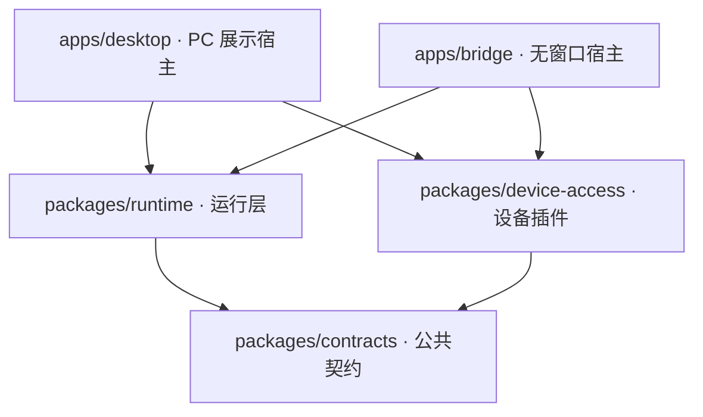

# watch-agent-pet 总体架构（v4，2026-11-19）

本文是目录与依赖边界的权威规范。当前产品是手表健康采集、PC 桌宠展示及本地 JSONL 存储；Agent 状态接入 PC 与模型分析是后期扩展，不向手表下发 Agent 状态。

## 1. 分层与依赖



箭头是源码依赖。两个应用入口负责注册设备，运行层通过注册表调用设备接口，生产代码不导入具体品牌。设备采样回调进入运行层，再经过会话、编码、传输、健康服务与本地存储，最终由展示层订阅快照。设备实现不导入运行层 Session，也不接触 Electron。

当前模拟链路在一个进程内托管采集端和接收端；真实手表将在设备端采集、通过网络向 PC 发送，届时应扩展单端连接接口，不要求 Android 与 PC 共用 JavaScript。

## 2. 目录与包

```text
watch-agent-pet/
  packages/
    contracts/                    公共消息、错误、接口与 Wire 草案
    device-access/                接入层，按机型组织
      simulator/                  独立 npm 模拟设备插件
      oppo-watch-4-pro/
        collector/                Android 探针源码与构建脚本
        tools/                    机型测试脚本
        docs/                     官方资料、实测报告、教程
        device.json               机型描述
    runtime/                      独立 npm 运行层
      index.js                    公共 API
      runtime.js                  生命周期和资源装配
      plugins/                    静态注册表
      services/                   健康快照与订阅
      connectivity/               Session / Codec / Transport
      storage/                    JSONL 本地存储
      config/                     配置加载与示例
      integrations/               后期扩展说明
      tests/                      运行层测试
  apps/
    desktop/                      独立 npm 展示层
      main/                       Electron 主进程与装配
      preload/                    受限 IPC
      renderer/                   桌宠、看板、配置界面
      platforms/                  PC 系统能力适配
      tools/                      桌面打包
      tests/                      桌面冒烟测试
      package.json                桌面依赖与 Electron 构建配置
    bridge/                       独立 npm 无窗口宿主
  tools/                          仓库级语法和依赖边界检查
  docs/                           架构与开发说明
  package.json                    workspace 与统一命令
  package-lock.json               统一依赖锁定
```

目前有五个 npm workspace：contracts、runtime、device-simulator、desktop、bridge。device-access 是接入层的分组目录，OPPO collector 是原生 Android 工程，不为了形式增加 Node 配置。未来每个 JavaScript 设备插件有自己的 package.json；原生采集工程使用对应工具链。

根目录保留 npm 配置是多包管理需要：根 manifest 不承载应用代码、Electron 配置或应用依赖；各包分别声明依赖与脚本，根目录统一安装、锁定和调度。npm 可将依赖提升到根 node_modules，这不改变包的责任边界。参见 [npm workspaces](https://docs.npmjs.com/cli/using-npm/workspaces/)。

跨包使用包名与 exports，不使用 `../../` 访问其他包内部文件。`npm run check` 检查语法、依赖声明、跨包相对路径和 Electron 泄漏。runtime 的 simulator 依赖仅供测试使用。

## 3. 可替换点

| 扩展点 | 放置位置 | 装配方式 |
|---|---|---|
| 手表硬件 | packages/device-access/<机型> | 宿主注入设备插件，配置选择 profile / instanceId |
| 字节传输 | runtime/connectivity/transports | 注册 Transport，配置选择通道 |
| 消息编码 | runtime/connectivity | 注册 Codec，配置选择协议 ID |
| PC 系统能力 | apps/desktop/platforms | 平台适配器报告能力与权限 |
| 展示方式 | apps/desktop 或新增应用宿主 | 消费 runtime 公共 API |

DeviceAdapter 当前实现 `describe()`、`start({onSample,onError})`、`stop()`；采样含指标、值、单位、时间和质量，运行层封装会话消息。设备能力与数据质量决定界面可用项，不在 UI 添加品牌判断，不把不可用数据伪造为 0。stop 必须释放采集资源。

Session 管理消息身份、序号和订阅，Codec 管理消息与字节转换，Transport 负责字节收发和关闭。目标中的 BLE 分片、远程配对、ACK、心跳、退避重连仍待实现；当前只实现 memory 和绑定 127.0.0.1 的 loopback-websocket。`open()` 返回成对连接用于模拟，不代表 LAN/BLE 接入已完成。

Windows/macOS/Linux 通过 Electron 平台适配隔离剪贴板、置顶、通知等能力。蓝牙、麦克风和输入注入等未实现能力返回 unsupported。渲染进程禁用 Node，通过受限 preload/IPC 访问主进程，不直接操作设备或文件系统。

## 4. 生命周期与配置

宿主注入可信插件 → 加载配置 → 校验插件 ID / API 版本 / 组合兼容性 → 运行层创建采集与通信资源 → 健康服务更新快照并写入本地数据 → UI 订阅。

配置只引用静态注册 ID，不动态 import 任意磁盘脚本。首版只启用一个设备；设备/通道热切换串行关闭旧资源并隔离旧回调；仅在配置允许时尝试备用通道。本地存储目录可以独立热切换，写盘失败报告状态而不中断采集。

默认配置是 [demo.json](../../packages/runtime/config/demo.json)。桌面持久化配置位于 Electron userData；[真机配置草案](../../packages/runtime/config/runtime.example.json)包含尚未注册的方案，导入会拒绝。OPPO 探针暂不读取 PC 配置。

桌面在主进程内装配运行层；bridge 在纯 Node.js 内装配相同运行层，两者没有相互导入。bridge 当前不是服务端，后续若拆守护进程需新增带鉴权的本地 IPC。

## 5. 迁移与验证

| 原位置 | 新位置 |
|---|---|
| devices | packages/device-access |
| devices/oppo-watch-4-pro/probe | packages/device-access/oppo-watch-4-pro/collector |
| core、connectivity、config、integrations | packages/runtime 对应职责目录 |
| contracts、core/errors.js | packages/contracts |
| apps/desktop/runtime.js、health-store.js | packages/runtime、runtime/storage |
| apps/desktop/bridge-cli.js | apps/bridge/main.js |
| apps/desktop/presentation、platforms | apps/desktop/renderer、platforms |
| tools/package-desktop.js、desktop-smoke.js | apps/desktop/tools、tests |

Android 包名 `com.owapet.sensorprobe` 与原 debug.keystore 保留，避免改变安装身份。根 results 保留。旧 apps/watch 只有设计占位说明，现合并到接入层说明；未来正式采集 App 放在对应机型下。

验证入口：`npm run check`、`npm test`、`npm run test:desktop`、`npm run pack`。三个 PC 系统分别构建和测试，Windows 验证不能替代 macOS/Linux 验证。硬件脚本须保持 UTF-8 BOM 并通过 PowerShell 5.1 解析；真机测试由用户执行。

## 6. 后续落地

当前已完成多包分层、静态插件运行时、模拟链路、PC 展示及本地存储。下一阶段按实测接通 OPPO 采集链路，验证 P2/P3/P4/P9；随后接入第二款手表和其他 PC 系统，检验可替换边界。详细现状、命令和插件步骤见[开发指南](../development/desktop-runtime.md)。

项目与当前工作区名称为 watch-agent-pet；Git 远程仓库重命名是独立操作，本次未修改。

> AI生成
