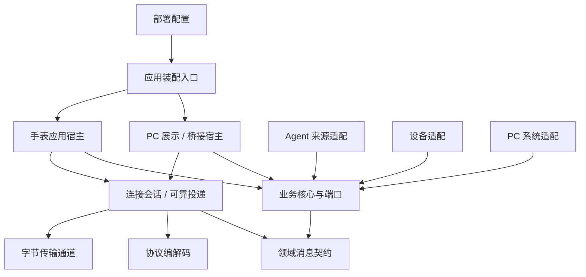

# watch-agent-pet 总体架构（v3，2026-11-19；同日修订：移除 Agent 状态跟随）

本文是目录与模块边界的权威规范。目标：按配置接入不同手表、替换通信方案、支持 Windows/macOS/Linux PC，让 PC 桥接和展示分别演进。

**产品定位（2026-11-19 修订）**：手表上报健康数据，PC 桌宠展示并采集到本地（数据目录可配置）；Agent 状态不下发手表（已移除）；Agent 状态接入 PC 与自定义模型分析为后期扩展。

## 1. 现状与范围

已实现：OPPO 探针、Electron PC 客户端、配置加载器、静态插件注册表、两种模拟设备、memory 与本机 WebSocket 链路、健康数据本地采集（JSONL 按天、目录可配置可热切换）。实现范围和启动方式见[开发指南](../development/desktop-runtime.md)。正式手表 App、BLE、LAN 配对及完整 Wire 可靠性仍待实现；跨系统 CI 已配置，需分别运行验证。

v2 的问题：watch 默认等于 OPPO Android；pc 混合业务、平台和 UI；Transport 同时承担 JSON 与连接职责；机型资料散落全局；协议禁止分片却又要求 BLE 拆包。v3 分别隔离这些变化点。

## 2. 分层与依赖



箭头表示编译期依赖。核心定义所需端口，适配器实现端口；只有应用装配入口知道具体实现。图示为逻辑模块，Android 与 PC 通过同一契约分别实现，不强求共享一种语言或运行时。Agents（Agent 来源适配）为后期扩展预留位，当前不注册实现。

数据路径（v3 修订）：手表核心 → 健康采样 → 会话/编码/传输 → PC 核心 → 桌宠/看板 UI，同时写入本地采集存储（JSONL，目录可配置）。Agent 来源 → AgentEvent → PC 端为后期扩展路径（不下发手表）。PC UI 从本地应用服务读取状态快照并订阅变化，不直接连接手表或读取私有 sensor。

## 3. 目录与职责

```text
watch-agent-pet/
  apps/desktop/              PC 展示与桥接入口（Electron）
  apps/watch/                正式手表应用入口（设计）
  core/                      业务服务、错误类型、插件注册表
  contracts/                 跨语言接口、Wire 协议草案
  devices/oppo-watch-4-pro/
    device.json              机型描述；区分候选与实测能力
    probe/                   探针 APK 源码和构建脚本
    tools/                   机型测试脚本、Windows 双击入口
    docs/official/           官方资料汇编
    docs/reports/            脱敏报告、dump
    docs/tutorials/          机型接入与探针教程
  connectivity/              本机会话、json codec、memory/WebSocket 通道
  platforms/                 Electron PC 系统能力适配
  integrations/              手动联调来源；真实 Agent 来源待实现
  config/                    配置加载器、可运行 demo 与真机草案
  docs/research/             架构、历史调研与通信决策
  tools/                     仓库级工具与本地 platform-tools
  results/                   原始实验输出，忽略入库
```

只为已有代码/资料和必要说明建目录，不生成空插件工程。现有 Java 包 `com.owapet.sensorprobe` 保留，避免改变已安装探针身份；新代码使用中性项目命名，品牌仅进入设备实现。

## 4. 三类可替换点

### 4.1 设备插件

DeviceAdapter 提供设备描述、运行时能力探测、标准输入事件、采集和生命周期。私有传感器编号、ABI/API、屏幕限制、权限、后台策略与厂商 SDK 均在机型目录下。相同 Android 行为待第二个机型接入后再提取公共实现。

能力区分 supported / unsupported / unknown / permission-required / temporarily-unavailable。健康值携带单位、采样时间、质量和设备标识；未佩戴、权限拒绝、数据过期不能转换成数值 0。UI 按能力启用功能，不能出现品牌判断分支。

配置 profile 选择驱动，instanceId 标识具体设备；连接后核验型号与运行时，不能把同一驱动默认为同一物理设备。接入不同 OS 的手表可能需要新应用宿主与语言实现，配置不能使不兼容二进制跨系统运行。

### 4.2 通信插件

| 层 | 职责 | 禁止混入 |
|---|---|---|
| Session | 配对、协商、心跳、重连、有界缓存、去重、主备切换 | OS 蓝牙调用、业务渲染 |
| Codec | 标准消息与字节互转，如 json-v1 | 连接与重试 |
| Transport | 字节收发、MTU 分片重组、背压，如 ble-gatt/websocket | 健康和 Agent 业务语义 |

通道交付完整字节消息，报告最大长度与链路能力。BLE 与 WebSocket 可用同一 codec；更换 JSON/CBOR 是换 codec，不能偷偷在 BLE 内改变消息语义。协议语义升级必须同步变更契约与双方实现，不能保证只换 codec 即兼容。

一条会话只有一个活动控制通道。切换：暂停新发送 → 关闭旧通道与订阅 → 按退避策略连接候选 → 鉴权/版本协商 → 恢复快照及允许补发的数据。失败进入离线；防止旧回调污染新会话或双通道重复执行命令。只使用配置允许的通道，不从加密连接静默降级到明文。

BLE 优先只是 OPPO 的待验证策略（P9），不是全局事实。开发先用模拟通道；音频能力不足时返回明确不可用原因，或根据用户配置切换到 Wi-Fi。

### 4.3 PC 系统插件

HostPlatform 隔离托盘、窗口置顶、通知、自动启动、凭据存储、麦克风和文本输入；蓝牙实现通过系统适配边界访问 OS。Windows/macOS/Linux 分别报告能力和权限，不支持自动注入时提供复制文本入口。

UI 仅依赖 DesktopService 的查询/订阅/命令接口。M1a 选择 Electron 宿主，使 PC 业务和插件共用 JavaScript；这替代了早期 Tauri 候选，Android 仍独立实现契约。桥接先作为同一进程中的独立模块；以后可经带鉴权的本地 IPC 拆成守护进程，不必现在引入微服务。

## 5. 配置与装配

见 [配置样例](../../config/runtime.example.json)和[接口契约](../../contracts/ports.md)。PC 使用 config/demo.json 及用户目录中的持久配置；OPPO 探针仍不读取这些配置。

启动顺序：校验 schemaVersion → 查询静态注册表 → 检查设备/OS/codec/transport 组合 → 探测权限和硬件 → 装配 → 配对连接 → UI 展示实际能力。未知插件、重复 instanceId、无共同协议版本要明确失败；只有配置允许且能力支持的候选才可回退。

首版采用编译期注册插件，通过配置选择，不加载任意磁盘脚本或动态库。配置为未来多设备预留数组，首版仅启用一个设备。PC 已支持设备与通道热切换，并串行关闭旧资源、隔离旧回调。密钥放 OS 凭据库，配置仅保存引用；首次配对需用户确认，后续核验身份；日志默认不保存健康原始数据和语音。

## 6. 扩展验收

| 场景 | 允许改动范围 | 验收 |
|---|---|---|
| 同运行时新机型 | devices、注册项、配置 | 模拟设备替代 OPPO，核心/UI 无品牌判断 |
| 新手表 OS | 以上 + apps/watch 对应宿主 | 共同消息测试向量通过 |
| BLE 换 WebSocket | transport、配置 | 相同消息投递，切换不重复控制 |
| JSON 换其他编码 | codec、协商、配置 | 消息往返一致，不改 sensor/UI |
| 新 PC 系统 | platforms、构建打包 | 对应系统 CI 构建，权限拒绝可降级 |
| PC UI 改版 | apps/desktop 展示模块 | 用模拟应用服务独立运行 |

## 7. 分阶段落地与迁移

1. 本次：展示名改为 watch-agent-pet；迁移机型资产、修正引用与脚本路径；落地契约和配置样例；同日修订产品定位——移除 Agent 状态跟随，手表只上报健康，PC 采集落盘（目录可配置）。
2. M1a（已实现）：静态注册表、配置加载器、模拟设备、两种通道、健康数据本地采集与 Electron 展示，覆盖健康数据质量、采集目录热切换与通道热切换。
3. M1b：接通一条实测可用链路；由用户验证 OPPO P2/P3/P4/P9，再加入第二条链路并测切换/恢复。
4. M1c：接入第二款手表和第二种 PC OS，验证可替换边界；再评估后期扩展（Agent 状态接入 PC、自定义模型分析、语音、组件）。

迁移：watch/sensor-probe → devices/oppo-watch-4-pro/probe；机型脚本和三组资料 → 对应 devices 子目录；pc → apps/desktop；shared → contracts。根目录 results 保留。

项目展示名与当前工作区物理目录、Git 远程地址独立。物理目录仍为 oppo-watch-agent-pet，可关闭工作区后改名并重新打开；GitHub 仓库重命名属于独立外部操作。本地旧 probe/build 若存在，应连同 debug.keystore 迁移，避免改变测试安装签名。

## 8. M1a 实现与目标架构的差异

当前会话仅支持有序本机链路，以新 epoch/快照恢复；无 ACK 补发、自动重连或远程配对。Transport 的成对 open 是模拟测试宿主接口，后续真实设备将分离单端 connect/accept。完整目标仍见上文，不能将目标能力当作已实现功能。平台代码统一通过 Electron 适配，暂不拆重复的三份 OS 文件。

> AI生成
